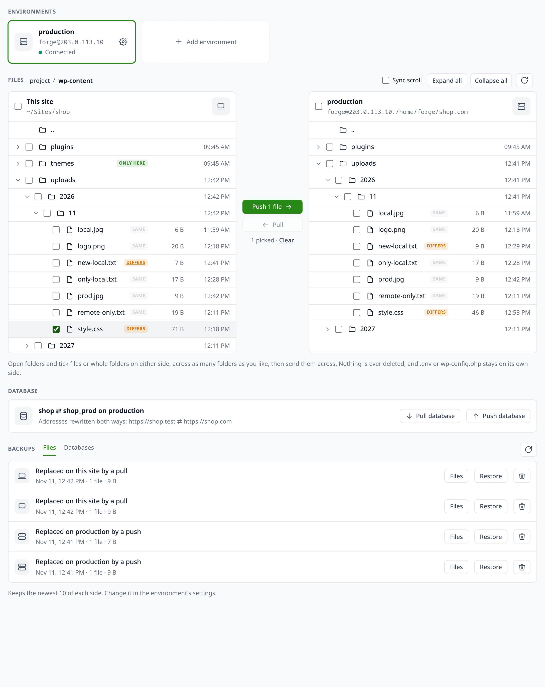

# sync

Brings a site's database and uploaded files down from its servers over SSH, or sends them back up, with an optional SQL step that scrubs personal data. Each server is an environment, such as production or staging.

## The Sync tab

Every site gets a **Sync** tab.

- **Environments** are cards along the top. Add one, or open its settings from the gear. Picking one checks the connection, and its dot shows whether SSH got in and found the database. The database password is saved but never shown again.
- **Files** shows the project as a tree, this site on the left and the server on the right. Click a folder to expand it on both sides, **Expand all** and **Collapse all** work on the folder at the top (up to 5000 entries, so open a smaller folder for big trees), and the arrow on a folder's row makes it the top. A badge marks what is only on one side or differs in size: click **differs** to open both versions in lerd's diff, server on the left, or **only here** to read that one copy in lerd's viewer. Tick files or whole folders, anywhere in the tree; the buttons count the files that will go, folders counted through, and **Push** or **Pull** copies them across, keeping their place in the project. Nothing is deleted on either side. Some paths are never synced and show a lock: each side's own config (`.env`, `.env.*`, `wp-config.php`, Drupal's `sites/*/settings.php`), its lerd setup (`.lerd/`, `.lerd.yaml`) and its repository (`.git/`). Add more per environment under **Never sync** in its settings, or with `setup --never '*.log, wp-content/cache/'`: a bare name matches anywhere, a path is from the project root, and a trailing slash marks a folder.
- **Backups**: before a transfer replaces a file, the old copy is kept, on the server in `~/.lerd-sync/files/` for a push and in the plugin's data folder under `backups/` for a pull, and the output says where. Each side keeps the newest 10 backups of a site and deletes older ones after a transfer; set the number per environment in its settings or with `setup --keep 30`, which counts database backups on the server too. Turn backups off per environment in its settings, or with `setup --backup off`. Database pushes always keep their backup, since a failed import restores from it.
- **Backups** lists what has been kept, under **Files** and **Databases**. A file backup shows when it was taken, on which side, and how many files; **Files** lists them and opens any in lerd's viewer, and **Restore** puts them back where they came from, keeping what that replaces as a new backup. Under **Databases** are the server's database backups, which restore after you type the environment's name, and lerd's snapshots of this site's database. The bin icon removes a backup or snapshot for good, after asking.
- **Database** pulls or pushes the whole database. A pull takes a local snapshot first. A push asks for the environment's name typed back, and backs the server up first.



## Set up a site once

Inside the project, once per environment:

```bash
lerd sync:setup --env production --ssh forge@203.0.113.10 --path /home/forge/shop.com \
  --files storage/app/public --sanitize .lerd/sanitize.sql
lerd sync:setup --env staging --ssh forge@203.0.113.11 --path /home/forge/staging.shop.com
```

| Option | Meaning |
|---|---|
| `--env name` | The environment to save, `production` when left out |
| `--ssh user@host`, `--ssh-port` | The server |
| `--path` | The project's folder on the server |
| `--url https://shop.com` | WordPress and Bedrock only: the server's address, swapped for the local one on a pull and back on a push. Needs wp-cli: Lerd 1.39, or `wp-cli/wp-cli-bundle` in the project |
| `--backup off` | Stop keeping a copy of files a transfer replaces; `on` brings it back |
| `--keep 10` | How many backups each side keeps, oldest deleted first |
| `--files a,b` | Folders inside the project to copy down and send up |
| `--sanitize file.sql` | SQL in the project to run over the pulled database |
| `--database`, `--db-user`, `--db-password`, `--db-host`, `--db-port` | Only when the server's `.env` or `wp-config.php` does not carry the database settings |

`lerd sync:setup` with no options lists the environments, and `--env staging --remove` forgets one.

SSH never prompts: your key must be loaded in an agent or have no passphrase, and the server must be in `known_hosts` already, so connect once with `ssh` first.

## Pull

| Where | How |
|---|---|
| Terminal | `lerd sync:pull`, `--env staging`, `--db-only` or `--files-only` |
| Dashboard | the site's Commands menu, **Pull from server**, from production or the first environment |
| AI assistant | `sync_pull` |

The pull replaces the site's local database after a `before-sync-pull` snapshot, which `lerd db:restore` brings back. A failed dump stops before anything local changes. Files are added and updated, never deleted locally. With more than one environment, name the one to pull from.

## Push

```bash
lerd sync:push --env staging --dry-run   # what the folders would send
lerd sync:push --env staging             # send the folders
lerd sync:push --env staging --db        # replace the server's database too
```

A push always names its environment. Folders are added and updated on the server, never deleted there, and a `.env` or `wp-config.php` inside them is never sent. A database push asks you to type the environment's name, or takes `--yes`. It works for MySQL and MariaDB: the dump is uploaded and checked, the server's database is backed up to `~/.lerd-sync/` on the server, then imported, and the backup goes back in if the import fails. With `--url` set, WordPress addresses are rewritten in the dump, serialized data included, without touching the local database. Assistants can pull but never push.

## From the terminal

Everything the tab does with files and backups has a command, run inside the project or with the site named:

```bash
lerd sync:status --dir wp-content --all                 # what is only here, only there, or differs
lerd sync:diff wp-content/themes/shop/style.css          # unified diff, server against this site
lerd sync:push --env staging --paths wp-content/themes/shop,robots.txt
lerd sync:pull --paths wp-content/uploads/2026            # only these, backed up like any pull
lerd sync:backups                                         # backups and snapshots, with their ids
lerd sync:backups --files pull:20261111T111800
lerd sync:backups --restore pull:20261111T111800          # asks first, or --yes
lerd sync:backups --remove db:backup-shop-20261111T104210.sql
```

A server database restore asks for the environment's name typed back, or takes `--yes`.

## AI assistants

`sync_pull` pulls the database, the configured folders, or just the `paths` given. `sync_status` lists what differs and `sync_backups` lists what has been kept, both read only. Pushing, restoring and removing stay with you, in the terminal or the tab.

## Older lerd

The diff and the file viewer the badges open need lerd 1.39 or newer. On an older lerd the badges are plain labels and everything else works.

## Scrubbing personal data

A pull brings the server's real data down, customers included. Turn on **Scrub personal data after a pull** in the Database card, or run `lerd sync:setup --env production --scrub on`, and a SQL file runs on this site's database after every pull from that environment.

Turning it on writes a starting point into `.lerd/scrub.sql`: for WordPress and Bedrock it empties emails, names, addresses and phone numbers of users, commenters and WooCommerce orders, using the site's table prefix, and keeps logins and passwords so you can still sign in; for Laravel it renames everyone in `users`, with the rest commented out for you to keep what your app has. **View** shows the SQL, **Edit** opens it in lerd's editor (or a plain text box on an older lerd), and the file is yours to change and commit. Turning scrubbing off keeps the file, and an edited file is never replaced. Every environment of a site shares `.lerd/scrub.sql` unless you pick **only <environment>** next to the switch, which gives that environment its own `.lerd/scrub-<environment>.sql`, starting as a copy of the shared one; switching back and forth never deletes or overwrites either file.

The scrub stops at the first failing statement and fails the pull, warning that the data may still hold personal details. It runs on your machine after the dump arrives, and uploaded files are never scrubbed.
