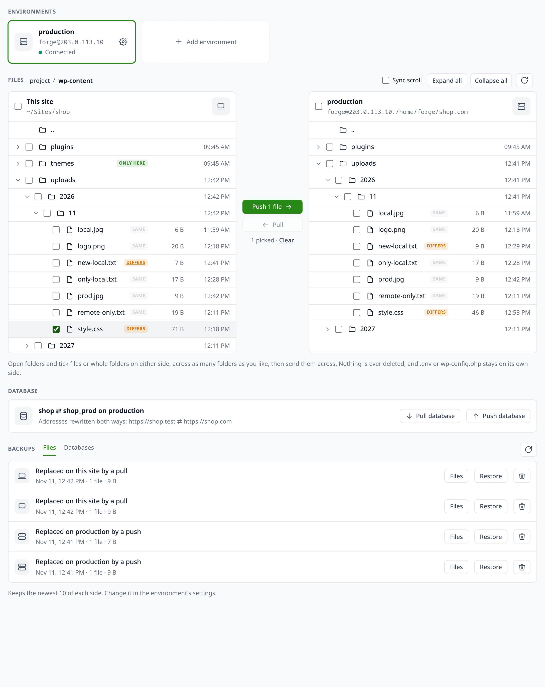

# sync for Lerd

Bring a site's real data down from its server: the production or staging database over SSH, an optional SQL step that scrubs personal data from it, and the folders users upload into. Like `lando pull` or DDEV's hosting providers, for any server you can SSH into: Forge, Ploi, a VPS, a shared host.

## Set up once per site

Inside the linked project:

```bash
lerd sync:setup --ssh forge@203.0.113.10 --path /home/forge/shop.com \
  --files storage/app/public --sanitize .lerd/sanitize.sql
```

| Option | Meaning |
|---|---|
| `--ssh user@host`, `--ssh-port` | The server, reached with your own SSH key or agent |
| `--path` | The project's folder on the server |
| `--files a,b` | Folders inside the project to copy down, comma separated |
| `--sanitize file.sql` | SQL in the project to run over the pulled database, such as replacing customers' emails |
| `--database`, `--db-user`, `--db-password`, `--db-host`, `--db-port` | The server's database, when its `.env` does not say it with `DB_DATABASE`, `DB_USERNAME` and friends |

SSH runs with `BatchMode=yes`, so it never waits on a prompt: the key must be loaded in an agent or have no passphrase, and the server must already be in your `known_hosts` (connect once with `ssh` to accept it).

## Pull

```bash
lerd sync:pull                 # database and files
lerd sync:pull --db-only
lerd sync:pull --files-only
```

The site's Commands menu on the dashboard gets **Pull from server**, and AI assistants get `sync_pull`. Each server is an environment (`setup --env staging ...`), and a site with several names the one to pull from with `--env`.

## The Sync tab

The dashboard gets a **Sync** tab on every site: a card per environment with its connection status, a two-pane browser of the project here and on the server where you tick files or folders and push or pull them, and the database pull and push.



## Push

```bash
lerd sync:push --env staging --dry-run   # preview the folders
lerd sync:push --env staging             # send the folders
lerd sync:push --env staging --db        # and replace the server's database, after a backup
```

Push is terminal only and always names its environment. A database push asks for the environment's name typed back, or `--yes`. For WordPress, `setup --url https://shop.com` rewrites the site's address both ways with `wp search-replace`, serialized data included.

## What it does

The database is dumped on the server with the server's own `mysqldump`, `mariadb-dump` or `pg_dump`, streamed back over SSH, and imported with `lerd db:import --fresh` after `lerd db:snapshot before-sync-pull`, so `lerd db:restore` undoes a pull. A failed dump stops before anything local changes. A MariaDB dump going into a MySQL service has its MariaDB-only collations and `NO_AUTO_CREATE_USER` swapped for what MySQL accepts. The sanitize SQL then runs through `lerd db:shell` and stops at its first failing statement, which fails the pull with a warning that the data may still be unscrubbed. Folders are copied with `rsync -az` and nothing local is deleted.

## What it reads, writes and sends

On the server it runs the database dump, reads the `DB_*` keys of the project's `.env` when you did not give them to `setup` (the rest of that file is not kept), and reads the folders you listed. A pull writes nothing on the server. A push writes the listed or picked files into the project there (never deleting, never sending a `.env` or `wp-config.php`), keeping each file it replaces under `~/.lerd-sync/files/` unless backups are turned off, and with `--db` uploads a dump to `~/.lerd-sync/`, backs the database up beside it (kept, readable only by you), imports, and deletes the upload. The tab lists the folders it shows on the server with `find` and reads a file there with `cat` to show it. Locally it writes the site's Lerd database and the listed folders inside the project. The dump passes through `tmp/` in the plugin's data folder and is deleted after the import. Each site's settings, including a database password you give `setup`, are kept in `sites/<site>.json` in the data folder, readable only by you. Nothing is sent anywhere but the server you named.

## Requirements

Node, which Lerd installs, `ssh` and `rsync` locally, and on the server the database's dump tool and `rsync`.

## License

MIT
